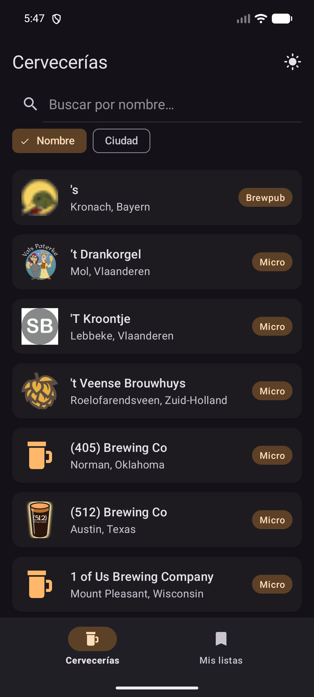
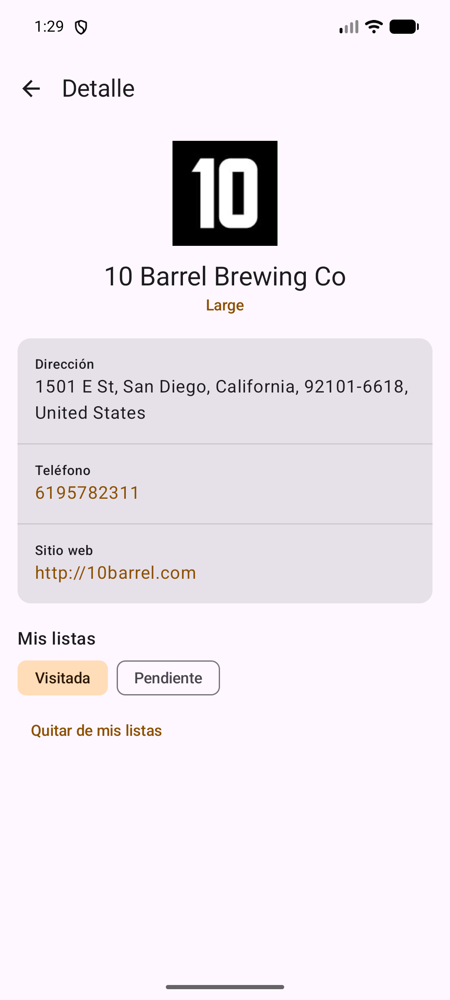
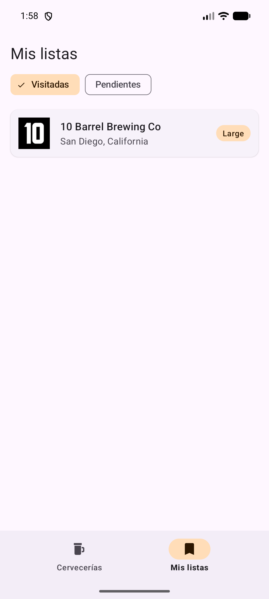

# 🍺 Directorio de Cervecerías

Aplicación Android para buscar cervecerías y productores artesanales usando la **[Open Brewery DB](https://www.openbrewerydb.org/)**, ver su información de contacto y guardarlas como **Visitadas** o **Pendientes por visitar**.
Desarrollada en **Kotlin** con arquitectura **MVVM** y una capa **Repository**.

> 🎥 **Video demostrativo:** [Ver acá](https://drive.google.com/file/d/1HdUmmh4JlsiRgZ4rmIMIH_qEOfHIahrb/view?usp=sharing)

---

## Capturas

<p align="center">
  
  &nbsp;&nbsp;
  
  &nbsp;&nbsp;
  
</p>

---

## Funcionalidades

- **Listado general** de cervecerías (RecyclerView) con logo, nombre, tipo de establecimiento y ciudad.
- **Buscador en tiempo real** por **nombre** o por **ciudad**, usando los parámetros `by_name` y `by_city` de la API (con *debounce* de 500 ms para no llamar a la API en cada letra).
- **Detalle en Jetpack Compose** con dirección completa, teléfono (abre el marcador) y sitio web (abre el navegador).
- **Mis listas (SQLite):** guardar cada cervecería como *Visitada* o *Pendiente*, cambiarla de lista o quitarla. Funciona **sin conexión**.
- **Detalle offline:** si no hay internet y la cervecería está guardada, se muestra la copia local.
- **Recuerda la última búsqueda** (texto y filtro) con SharedPreferences.
- **Manejo de errores:** sin conexión, tiempo de espera agotado, errores HTTP, JSON inválido, errores de base de datos, búsquedas sin resultados y apps externas inexistentes.
- **Soporta la rotación** de pantalla sin perder datos ni repetir peticiones.
- **Tema claro y oscuro** con una paleta ámbar propia.

---

## Tecnologías

| Área | Tecnología |
|---|---|
| Lenguaje | Kotlin |
| Arquitectura | MVVM + Repository Pattern |
| Red | Retrofit + Gson |
| Asincronía | Corrutinas de Kotlin (`viewModelScope`, `Dispatchers.IO`) |
| Estado de la UI | ViewModel + LiveData (`observeAsState` en Compose) |
| Listas | RecyclerView + `ListAdapter` + `DiffUtil` (XML + ViewBinding) |
| Navegación | Fragments + `BottomNavigationView` |
| Detalle | Jetpack Compose + Material 3 |
| Imágenes | Picasso |
| Persistencia | SQLite (`SQLiteOpenHelper`) + SharedPreferences |

---

## Arquitectura (MVVM)

```
 View (Fragment / Compose)  ──observa LiveData──▶  ViewModel  ──▶  Repository  ──▶  Retrofit (API)
          │                                            ▲                       └──▶  SQLite (DAO)
          └────────── acciones del usuario ────────────┘
```

- **View:** solo dibuja el estado (`UiState`) y le avisa al ViewModel lo que hace el usuario.
- **ViewModel:** guarda el estado de la pantalla, sobrevive a la rotación y lanza las corrutinas.
- **Repository:** única puerta de acceso a los datos. Envuelve cada llamada en `safeCall`, que corre en `Dispatchers.IO` y atrapa las excepciones en un `Result`.

### Estructura de carpetas

```
com.example.points/
├── data/
│   ├── model/        Brewery, FavoriteStatus, SearchFilter
│   ├── remote/       BreweryApi (Retrofit), RetrofitClient
│   ├── local/        BreweryDbHelper, FavoritesDao, PreferencesManager
│   └── repository/   BreweryRepository, FavoritesRepository
├── ui/
│   ├── main/         MainActivity (contenedor + barra de navegación)
│   ├── list/         BreweryListFragment, BreweryListViewModel, BreweryAdapter
│   ├── favorites/    FavoritesFragment, FavoritesViewModel
│   ├── detail/       DetailActivity, DetailScreen, DetailComponents, DetailViewModel
│   └── theme/        BreweryTheme (Compose)
└── util/             UiState, SafeCall, ErrorMapper, FaviconUrl, ViewModelFactory
```

### Patrones de diseño utilizados

| Patrón | Dónde |
|---|---|
| Repository | `BreweryRepository`, `FavoritesRepository` |
| Singleton | `RetrofitClient`, `BreweryDbHelper.getInstance()` |
| Factory | `ViewModelFactory` |
| Observer | `LiveData` observado por Fragments y Compose |
| Adapter | `BreweryAdapter` (reutilizado en las dos listas) |
| DAO | `FavoritesDao` (único lugar con SQL) |
| State | `sealed class UiState` (Loading / Success / Error) |

---

## API utilizada

Base URL: `https://api.openbrewerydb.org/v1/`

| Uso | Endpoint |
|---|---|
| Listado general | `GET breweries?page=1&per_page=20` |
| Filtro por nombre | `GET breweries?by_name={nombre}` |
| Filtro por ciudad | `GET breweries?by_city={ciudad}` |
| Detalle | `GET breweries/{id}` |

La API no provee imágenes, así que se muestra el **favicon del sitio web** de cada cervecería
(`https://www.google.com/s2/favicons?sz=128&domain={dominio}`), descargado con Picasso.
Si la cervecería no tiene sitio web o el ícono no existe, Picasso muestra un ícono local.

---

## Base de datos local

Tabla `favorites`:

| Columna | Tipo | Descripción |
|---|---|---|
| `id` | TEXT (PK) | id de la API |
| `name`, `brewery_type`, `street`, `city`, `state`, `postal_code`, `country`, `phone`, `website_url` | TEXT | datos para mostrarla sin conexión |
| `status` | TEXT | `VISITED` o `PENDING` |
| `saved_at` | INTEGER | fecha de guardado (ordena de más nueva a más vieja) |

---

## Cómo ejecutarla

1. Clonar el repositorio: `git clone https://github.com/Tomszip/Points.git`
2. Abrirlo con **Android Studio** y esperar la sincronización de Gradle.
3. Ejecutar en un emulador o dispositivo con **Android 7.0 (API 24)** o superior y conexión a internet.
